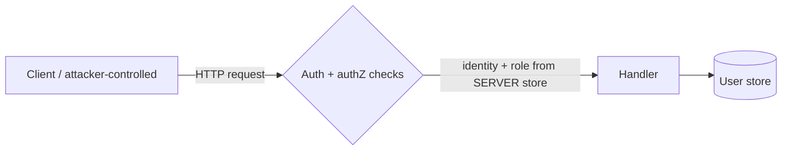

# Week 1 — Cybersecurity & networking foundations: HTTP/API security

Status: written for study. The lab in `labs/lab-01-web-security` was run on 2026-10-12 (17 tests passed, Python 3.13, FastAPI 0.143.0, Starlette 1.7.0, pytest 9.1.1). Statements about industry practice below are general knowledge, not individually sourced; verify against the references before citing.

## 1. Objectives & prerequisites
After this week you can: define CIA, asset, threat, vulnerability, risk, least privilege, defense in depth; read an HTTP exchange and spot trust decisions; distinguish authentication from authorization; find and fix two classic access-control flaws; write tests that fail if the fix regresses.
Prereqs: Python, FastAPI basics.

## 2. Plain-language explanation
- **Authentication (authN):** who are you? **Authorization (authZ):** what may you do? Most API breaches that matter for AI products are authZ failures, not clever model tricks.
- **CIA triad:** Confidentiality (only the right people read), Integrity (only the right changes), Availability (it keeps working).
- **Risk** ≈ likelihood × impact of a threat exploiting a vulnerability against an asset.
- **Least privilege:** grant the minimum access needed. **Defense in depth:** several independent controls so one failure is not fatal.

## 3. Technical mechanism
HTTP is stateless. Each request carries everything the server uses to decide identity: headers, cookies, tokens. **Anything in a request is attacker-controlled.** Therefore:
1. Identity must be proven by something the client cannot forge (signed token, server session).
2. Roles/permissions must be looked up server-side, never read from the request.
3. Every object access needs an ownership/permission check (object-level authorization).

TLS protects data in transit; it does not fix authZ bugs. Cookies/sessions/tokens are just different carriers of the same proof.

## 4. Architecture & trust boundary

Trust boundary: the network edge. Everything left of the check is untrusted input.

## 5. Assets, actors, surface, impact
| | |
|---|---|
| Assets | User profiles/notes, admin user list, signing secret |
| Actors | Anonymous caller; authenticated normal user (curious or malicious); stolen-token holder |
| Capabilities | Send arbitrary headers/paths; replay or tamper with tokens |
| Preconditions | Network reach to the API; for IDOR, any valid account |
| Surface | `/login`, `/profile`, `/profile/{username}`, `/admin/users` |
| Impact | Disclosure of other users' data (C), privilege escalation to admin (C/I) |

## 6. Lab (see `labs/lab-01-web-security`)
Setup:
```bash
cd labs/lab-01-web-security
python -m venv .venv && source .venv/bin/activate
pip install -r requirements.txt
pytest -q
```
Reproduction on the vulnerable variant (`create_app(secure=False)`):
- `GET /admin/users` with headers `X-User: mallory`, `X-Role: admin` → **200** (expected for a secure app: 401/403).
- `GET /profile/bob` as `X-User: alice` → **200** with bob's private note (expected: 403).

Observed result: both flaws reproduced by `test_vuln_*`; the secure variant blocks them (tests below).

## 7. Root cause
- **Privilege escalation:** the server trusted a client-supplied role header (authN and authZ both delegated to the client).
- **BOLA/IDOR:** the handler authenticated the caller but never checked that the caller owns the requested object.

## 8. Defense & trade-offs
| Control | Why it works | Trade-off / limit |
|---|---|---|
| HMAC-signed, expiring bearer token | Client cannot forge or extend it without the secret | Not revocable before expiry; secret leak = full compromise; production should use a vetted library/IdP |
| Role from server store | Removes the client from the decision | Needs a source of truth to keep current |
| Per-object ownership/admin check | Closes IDOR | Must be repeated on every route; centralize as you grow |
| Same error for bad user / bad password + dummy hash | Reduces user enumeration | Timing/rate-limit side channels remain; no rate limiting in this lab |
| PBKDF2 password hashing, constant-time compare | Slows offline cracking, avoids timing leak | 100k iterations is a lab value, not a recommendation; check current guidance |
| Input length limits (Pydantic) | Cuts trivial abuse | Not a full validation strategy |
| Security headers, denial logging w/o secrets | Hardening and detection | Headers matter little for a JSON API; no alerting here |

## 9. Regression tests & method
`tests/test_auth.py`: 2 flaw reproductions + 15 control tests (no token, forged headers, tampered token, expired token, enumeration, oversize input, user→admin blocked, admin allowed, cross-user read blocked, own read allowed, role-from-request ignored, headers, log contents). Method: each fix has a test that would fail if the check were removed. To prove that, temporarily delete a check and watch the matching test fail (I ran this for the ownership check: removing it made `test_user_cannot_read_other_profile` fail, 1 failed/16 passed; other checks not mutation-tested).

## 10. Industry relevance
Broken access control and object-level authorization are consistently top-ranked API risks in OWASP material (verify current OWASP API/Web Top 10 wording). In AI products the same bugs appear when a tool or retrieval endpoint trusts the model or client to say who the user is.

## 11. Framework mapping
OWASP GenAI: relevant later as "excessive agency" and "sensitive information disclosure" when these flaws sit behind LLM tools (confirm current names on the live page). MITRE ATLAS: not the focus this week. NIST AI RMF: *Govern/Map* (asset and access inventory).

## 12. Limitations & residual risk
Not covered: rate limiting/brute force, token revocation, CSRF/cookies, TLS config, secret rotation, real IdP. SQLi and SSRF are addressed in Week 2 (`00-foundations/web-api-vulnerabilities.md`). Tests prove behavior of these routes only; they can miss routes you forget to protect. A new endpoint is unprotected unless it uses the dependency.

## 13. Self-assessment
1. Why can `X-Role: admin` not be trusted even over TLS?
2. Which test fails if you delete the ownership check in `/profile/{username}`? Verify.
3. Why return the same error for unknown user and wrong password? What still leaks?
4. Give one case where authN succeeds and authZ must still deny.
5. Why is an HMAC token not a revocation solution?
6. Add `/notes/{id}` with owner field: write the failing test first.

**Flashcards:** authN vs authZ · BOLA/IDOR · least privilege · defense in depth · constant-time compare · token expiry · enumeration.

**Interview prompts:** "Walk me through how you'd secure a /admin route." "What is BOLA and how do you test for it?" "Why isn't a hidden UI button access control?"

## 14. References (last-verified: reachable 2026-10-12; content not re-read)
- PortSwigger Web Security Academy — https://portswigger.net/web-security/getting-started
- OverTheWire Bandit — https://overthewire.org/wargames/bandit/
- OWASP GenAI LLM Top 10 — https://owasp.org/www-project-top-10-for-large-language-model-applications/
