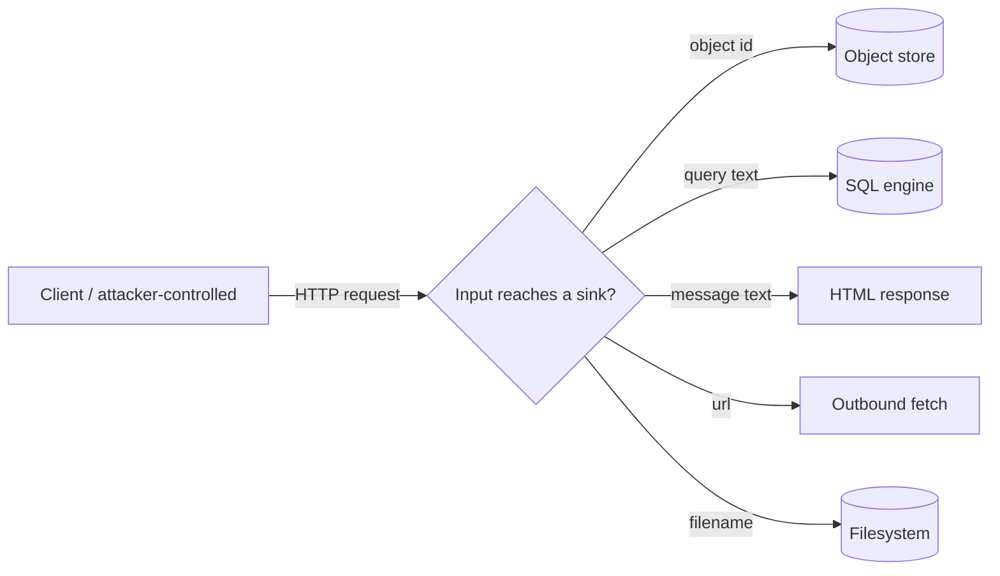

# Week 2 — Web/API vulnerabilities: BOLA/IDOR, SQL injection, XSS, SSRF, path traversal

Status: written for study. The lab in `labs/lab-01-web-security` was run on 2026-10-12 (33 tests passed, Python 3.11.9, FastAPI 0.141.1, Starlette 1.7.0, pytest 8.4.2). Statements about industry practice below are general knowledge, not individually sourced; verify against the references before citing.

## 1. Objectives & prerequisites
After this week you can: explain and reproduce BOLA/IDOR, SQL injection, reflected XSS, SSRF, and path traversal; identify the untrusted input and the trust boundary each crosses; patch each with the standard control (ownership check, parameterized query, output encoding, allowlist/host validation, path containment check); write a regression test per vuln.
Prereqs: Week 1 (authN vs authZ, trust boundaries).

## 2. Plain-language explanation
- **BOLA/IDOR** (Broken Object-Level Authorization / Insecure Direct Object Reference): the app checks *who you are* but not *whether you may touch this specific object*. Week 1 covered this for `/profile/{username}`; this week adds a second instance (`/orders/{id}`) to show it is a pattern, not a one-off bug.
- **SQL injection (SQLi):** untrusted input is concatenated into a SQL query string, letting an attacker change the query's logic (e.g. turn a search into a `UNION` that reads a different table).
- **Cross-site scripting (XSS):** untrusted input is placed into an HTML response without encoding, so the browser executes it as markup/script instead of displaying it as text.
- **Server-side request forgery (SSRF):** the server fetches a URL supplied by the client, so the attacker can make the server reach hosts it would not otherwise reach (cloud metadata services, internal admin tools).
- **Path traversal:** untrusted input is used to build a filesystem path without normalizing `..`, letting the caller read files outside the intended directory.

All five share one root cause: **untrusted input reaches a sensitive sink (object lookup, SQL engine, HTML renderer, outbound fetch, filesystem) without a check at the trust boundary.**

## 3. Technical mechanism
1. Each sink has its own safe construction primitive — never reassemble it from trusted + untrusted fragments by hand:
   - Object access: check ownership/role server-side before returning the object.
   - SQL: use parameterized queries/bound parameters; never format strings into SQL.
   - HTML output: encode on output (`html.escape` or a templating engine's auto-escaping), not on input.
   - Outbound fetch: validate scheme and destination (reject loopback/link-local/private ranges and non-allowlisted hosts) before the request is made, not after.
   - Filesystem paths: resolve the final path and verify it is still inside the intended root before touching the filesystem.
2. Validate at the boundary where trust changes (client → server), not deep inside business logic where it's easy to forget.
3. A fix that encodes/escapes/parameterizes *some* call sites but not others gives a false sense of safety — every sink needs its own check.

## 4. Architecture & trust boundary

Trust boundary: the same network edge as Week 1. The new detail is that it isn't one boundary — it's one per sink, and each sink needs its own control.

## 5. Assets, actors, surface, impact
| | |
|---|---|
| Assets | Orders table, product catalog, users table (mirrored username/role), served files, egress from the API server |
| Actors | Authenticated normal user (curious or malicious); attacker reaching the server from outside |
| Capabilities | Send arbitrary query strings, search terms, HTML-breaking text, URLs, and filenames |
| Preconditions | Network reach to the API; a valid account (for the authenticated endpoints) |
| Surface | `/orders/{id}`, `/search`, `/echo`, `/fetch-avatar`, `/files` |
| Impact | Disclosure of other users' orders and the users table (C); reflected script execution in a victim's browser (I/C); server-side fetch of internal-only endpoints (C); disclosure of files outside the intended directory (C) |

## 6. Lab (see `labs/lab-01-web-security`)
Setup:
```bash
cd labs/lab-01-web-security
python -m venv .venv && source .venv/bin/activate
pip install -r requirements.txt
pytest -q
```
Reproduction on the vulnerable variant (`create_app(secure=False)`):
- `GET /orders/2` as `X-User: alice` → **200** with bob's order (expected: 403).
- `GET /search?q=' UNION SELECT username FROM users --` → **200** including `root_admin` (expected: parameterized query ignores the injection).
- `GET /echo?msg=<script>alert(1)</script>` → response body contains the raw `<script>` tag (expected: HTML-escaped).
- `POST /fetch-avatar {"url": "http://169.254.169.254/latest/meta-data/"}` → **200** with a simulated metadata body (expected: 400, host blocked). The lab simulates the fetch internally rather than making a real network call, so this is deterministic and offline — see §12.
- `GET /files?name=../secret.txt` → **200** with the secret file's contents (expected: 400, path escapes the served root).

Observed result: all five flaws reproduced by `test_vuln_*` in `tests/test_web_vulns.py`; the secure variant blocks every one (18 tests in that file, plus the 15 unmodified Week 1 tests in `tests/test_auth.py`, all passing).

## 7. Root cause
- **BOLA/IDOR (orders):** same root cause as Week 1's profile flaw — authenticated but not authorized against the specific object.
- **SQLi:** the search query was built with an f-string instead of a parameter placeholder.
- **XSS:** the echo endpoint wrote client input directly into an HTML response with no output encoding.
- **SSRF:** the fetch endpoint accepted any URL and dispatched it without checking scheme or destination.
- **Path traversal:** the file endpoint joined client input onto a base directory without resolving and containing the result.

## 8. Defense & trade-offs
| Control | Why it works | Trade-off / limit |
|---|---|---|
| Per-object ownership/admin check on `/orders/{id}` | Closes IDOR, same pattern as Week 1 | Must be added to every new object-returning route by hand |
| Parameterized query for `/search` | DB driver separates code from data; injected text can't change query structure | Only protects the query path it's applied to — a second raw-SQL call elsewhere is still vulnerable |
| `html.escape()` on `/echo` output + `Content-Security-Policy` header | Neutralizes markup/script in the reflected value; CSP is a second layer if escaping is ever missed | Escaping must be applied at every output sink, not just this one; CSP here is a strict `default-src 'none'` lab default, not a tuned real-world policy |
| Scheme + host validation before fetch on `/fetch-avatar` | Rejects loopback/link-local/private destinations before any request is made | This lab's validator checks literal IPs and a short internal-name list; it does not resolve DNS, so a hostname that resolves to an internal IP at request time would not be caught (see §12) |
| `os.path.realpath` + containment check on `/files` | Guarantees the resolved path cannot leave the served root, regardless of how many `..`/encoding tricks are used | Only as strong as the containment check itself; must run after resolving symlinks, not before |

## 9. Regression tests & method
`tests/test_web_vulns.py`: 5 flaw reproductions (`test_vuln_*`) + 13 control/behavior tests (ownership allow/deny for orders, parameterized search still finds real matches, escaped output still renders non-malicious text, CSP header present, SSRF allows a non-blocked external host, traversal-safe lookups still serve the public file). Fixtures (`vuln`, `sec`) and the `token()` helper were extracted from `test_auth.py` into `tests/conftest.py` so both files share them without duplication — this is a pure refactor; `test_auth.py`'s own 15 tests were re-run unchanged and still pass. Method: each fix has a test that would fail if the check were removed; this was exercised during development (each endpoint was implemented only after watching its test fail for the right reason, not mutation-tested after the fact).

## 10. Industry relevance
Injection, broken access control (which subsumes BOLA/IDOR), and SSRF are consistently high-severity categories across OWASP's Web and API Top 10 lists (verify current OWASP wording before citing exact rank). In AI products, the same patterns surface when: a RAG retrieval endpoint trusts a client-supplied document/object id (BOLA), a tool call builds a query from model output without parameterization (SQLi-equivalent), a chat UI renders model output as raw HTML (XSS), an agent is given a "fetch this URL" tool without destination validation (SSRF), or a file-reading tool accepts a model-controlled path (path traversal).

## 11. Framework mapping
OWASP GenAI/LLM Top 10: SSRF and injection map onto "excessive agency" and "insecure output handling" when these sinks sit behind an LLM tool call rather than a direct HTTP request (confirm current category names on the live page). MITRE ATLAS: relevant once an agent's tool-calling surface reintroduces these as agent-mediated attacks (not the focus this week — that's Week 7). NIST AI RMF: *Govern/Map* (inventory of sinks reachable from model-controlled input).

## 12. Limitations & residual risk
- SSRF is validated against a synthetic/mocked host set only (`_resolve()` returns canned bodies; no real DNS resolution or network egress). This means: no DNS-rebinding coverage, and a hostname that only *resolves* to an internal IP (rather than being a literal internal IP) would not be caught by this lab's validator.
- Path traversal fix is OS-path-based (`realpath` + containment check) only — no chroot, no OS-level sandboxing; symlink edge cases beyond `realpath`'s resolution are not separately tested.
- XSS fix covers reflected XSS on one endpoint only; no stored XSS (nothing is persisted and re-rendered) and no DOM-based XSS (there is no real frontend/JS in this lab).
- SQLi fix is demonstrated on one query path (`/search`); the lab does not audit for a second, unparameterized query elsewhere.
- Carried over from Week 1, still not addressed: rate limiting/brute force, token revocation, CSRF/cookies, TLS config, secret rotation, real IdP.
- Tests prove behavior of the routes they target only; a new endpoint is unprotected unless it explicitly uses the matching control.

## 13. Self-assessment
1. Why is BOLA on `/orders/{id}` "the same bug" as BOLA on `/profile/{username}` from Week 1, even though the code is different?
2. Why does parameterizing `/search`'s query fix SQLi even though the attacker's string still reaches the database?
3. Why must XSS output-encoding happen at the point of writing HTML, not at the point of reading the input?
4. The SSRF guard in this lab blocks literal internal IPs but not hostnames that resolve to them. How would you close that gap in a real system?
5. Why does the path-traversal fix call `os.path.realpath` before the containment check, not after?
6. Add a new endpoint that reads a file by name: write the failing traversal test first.

**Flashcards:** BOLA/IDOR · parameterized query · output encoding vs input validation · SSRF host allowlisting · path containment check · trust boundary per sink.

**Interview prompts:** "How would you find every place in a codebase that's vulnerable to SQL injection?" "Why doesn't blocklisting `<script>` fix XSS?" "What's the difference between validating a URL's scheme and validating its destination, and why do you need both for SSRF?"

## 14. References (last-verified: reachable 2026-10-12)
- PortSwigger Web Security Academy — SQL injection — https://portswigger.net/web-security/sql-injection
- PortSwigger Web Security Academy — Cross-site scripting — https://portswigger.net/web-security/cross-site-scripting
- PortSwigger Web Security Academy — SSRF — https://portswigger.net/web-security/ssrf
- PortSwigger Web Security Academy — Path traversal — https://portswigger.net/web-security/file-path-traversal
- PortSwigger Web Security Academy — Access control (BOLA/IDOR) — https://portswigger.net/web-security/access-control
- OWASP Juice Shop — https://owasp.org/www-project-juice-shop/
